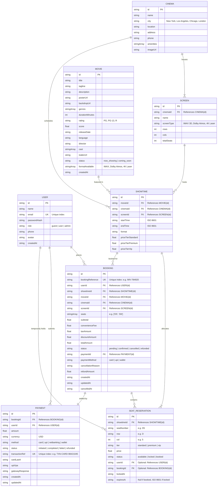

# Entity Relationship (ER) Diagram

## 1. Complete ER Diagram

The following Mermaid entity-relationship diagram illustrates the data models, cardinality, references, and attributes implemented across the IMovies platform.

---

## 2. Entity Descriptions & Relationships

| Entity | Primary Key | Foreign Keys / References | Description |
| :--- | :--- | :--- | :--- |
| **User** | `id` | None | Stores registered account details, hashed passwords, roles (`guest`, `user`, `admin`), and contact information. |
| **Movie** | `id` | None | Master catalog of films, including synopses, posters, duration, age rating, IMDb/Rotten score, and trailer embed URLs. |
| **Cinema** | `id` | None | Physical cinema theater venue, location details, municipal address, telephone, and venue amenities (IMAX Laser, VIP Lounge, Dine-in). |
| **Screen** | `id` | `cinemaId` $\to$ `Cinema.id` | Individual auditorium within a cinema complex, defining physical layout dimensions (rows $\times$ cols), total capacity, and projection technology. |
| **Showtime** | `id` | `movieId` $\to$ `Movie.id` `cinemaId` $\to$ `Cinema.id` `screenId` $\to$ `Screen.id` | A scheduled screening of a film in a specific auditorium at a designated start and end time with tiered ticket pricing. |
| **SeatReservation** | `id` | `showtimeId` $\to$ `Showtime.id` `userId` $\to$ `User.id` `bookingId` $\to$ `Booking.id` | Represents individual seat states (`available`, `locked`, `booked`). Holds temporary concurrency locks (`expiresAt`) during checkout. |
| **Booking** | `id` | `userId` $\to$ `User.id` `showtimeId` $\to$ `Showtime.id` `paymentId` $\to$ `Payment.id` | Order manifest recording selected seats, optional concessions, financial calculation (fees, taxes, discounts), reference codes, and status. |
| **Payment** | `id` | `bookingId` $\to$ `Booking.id` `userId` $\to$ `User.id` | Transaction record detailing gateway settlement, method (Card, UPI, Wallet), last 4 digits, status, and bank authorization codes. |

---

## 3. Database Indexes, Unique Constraints, and Integrity Rules

### 3.1 Unique Indexes
1. **`users.email`**:
   - Unique constraint enforcing that each registered account possesses a distinct email address. Case-insensitive lowercase collation.
2. **`bookings.bookingReference`**:
   - Unique alphanumeric constraint in format `IMV-XXXXXX` (e.g., `IMV-784920`) ensuring ticket lookup idempotence and fraud prevention.
3. **`payments.transactionRef`**:
   - Unique reference identifier (e.g., `TXN-CARD-98421045`) generated per transaction attempt to prevent double-charging.
4. **`seatReservations.showtimeId + seatNumber` (Composite Unique Index)**:
   - Ensures that within a given showtime, no two records can exist for the same physical seat (e.g., `Showtime: st_1, Seat: D5`).

### 3.2 Concurrency & Referential Integrity Constraints
- **Atomic Seat Lock Check**: Before transitioning a seat to `locked` or `booked`, the system queries the composite key `(showtimeId, seatNumber)`. If `status === 'booked'` or (`status === 'locked'` and `userId !== currentUserId` and `expiresAt > now`), the operation fails with HTTP 409.
- **Cascade Release on Expiry**: If `expiresAt < now`, the seat automatically reverts to `available` and clears `userId` and `lockedAt`.
- **Foreign Key Referencing**:
  - `Showtime` requires existing `Movie`, `Cinema`, and `Screen` IDs.
  - `Booking` references valid `Showtime` and `User` IDs.
  - `Payment` requires a corresponding `Booking` in `pending` status.
