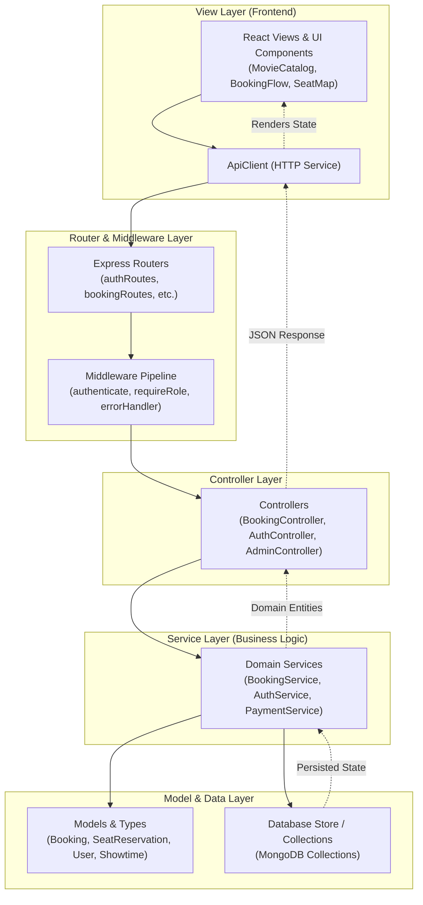
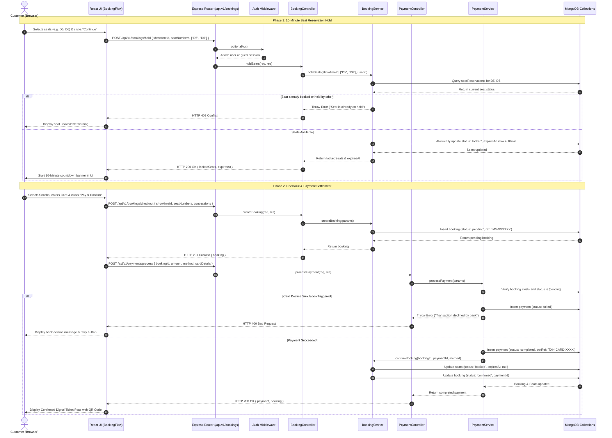

# MVC Architectural Pattern

## 1. Architectural Layers Overview

IMovies adheres to a layered **Model-View-Controller (MVC)** architectural pattern adapted for modern TypeScript Single Page Applications and decoupled RESTful Express backends.

---

## 2. Component Layer Responsibilities

### 2.1 Models (`server/models/types.ts`)
- **Responsibility**: Defines domain entities, types, relationships, and validation contracts.
- **Key Entities**:
  - `User`: Identity, role taxonomy (`guest`, `user`, `admin`), password hashes, and profiles.
  - `Movie`: Catalog titles, metadata, age classifications, and video trailer URLs.
  - `Cinema` & `Screen`: Physical venues, audio/visual capabilities, and seat matrix dimensions.
  - `Showtime`: Schedule associations between movies, screens, and tiered pricing.
  - `SeatReservation`: Individual seat state representation (`available`, `locked`, `booked`).
  - `Booking`: Customer order manifests, seat arrays, itemized fees, and status state machines.
  - `Payment`: Transaction ledgers, card last 4 digits, gateway references, and authorization codes.

### 2.2 Views (`src/components/`, `src/App.tsx`)
- **Responsibility**: Renders reactive UI, handles user input, communicates with the API, and enforces accessibility.
- **Key View Components**:
  - `App.tsx`: Main application shell, routing tabs, city selection context.
  - `Navbar.tsx`: Brand wordmark, city dropdown, navigation tabs, user persona switch.
  - `HeroFeatured.tsx`: Blockbuster spotlight with trailer CTA.
  - `MovieCatalog.tsx`: Filterable movie grid.
  - `MovieModal.tsx`: YouTube trailer player dialog.
  - `BookingFlow.tsx`: Multi-step seat map, snack upsells, checkout, and digital ticket pass.
  - `MyBookingsView.tsx`: Customer ticket portfolio and cancellation interface.
  - `AdminDashboard.tsx`: Executive operations dashboard and scheduler.
  - `DocumentationViewer.tsx`: In-app system and architecture specification explorer.

### 2.3 Controllers (`server/controllers/`)
- **Responsibility**: Unpacks HTTP requests, validates parameters, orchestrates domain services, and formats standard HTTP responses.
- **Controllers**:
  - `AuthController`: Manages user registration, login, and current profile (`/me`).
  - `MovieController`: Public queries with search/genre filters, and admin CRUD operations.
  - `CinemaController`: Venue listings, screens, and concessions catalog.
  - `ShowtimeController`: Film scheduling lookups and auditorium seat map generation.
  - `BookingController`: Seat hold requests, checkout creation, user bookings, reference lookups, and cancellations.
  - `PaymentController`: Multi-channel payment execution and transaction status queries.
  - `AdminController`: Dashboard operational metrics and showtime creation.

### 2.4 Routes (`server/routes/`)
- **Responsibility**: Maps URL paths and HTTP verbs to controller methods and applies route-specific middleware.
- **Route Definitions**:
  - `authRoutes.ts`: Mounted at `/api/v1/auth`
  - `movieRoutes.ts`: Mounted at `/api/v1/movies`
  - `cinemaRoutes.ts`: Mounted at `/api/v1/cinemas`
  - `showtimeRoutes.ts`: Mounted at `/api/v1/showtimes`
  - `bookingRoutes.ts`: Mounted at `/api/v1/bookings`
  - `paymentRoutes.ts`: Mounted at `/api/v1/payments`
  - `adminRoutes.ts`: Mounted at `/api/v1/admin`

### 2.5 Services (`server/services/`)
- **Responsibility**: Encapsulates pure business logic independent of the HTTP transport layer.
- **Services**:
  - `AuthService`: Password hashing with salt (SHA-256), HMAC-SHA256 JWT encoding, and decoding.
  - `BookingService`: Atomic seat locking with 10-minute hold expiry, fee calculation, convenience fees, and tiered refund percentage calculation.
  - `PaymentService`: Payment gateway simulation for cards, UPI, and wallets, with deterministic test scenarios and failure simulation.
  - `MovieSyncService`: External catalog mapping and metadata fallback.

### 2.6 Middleware (`server/middleware/`)
- **Responsibility**: Cross-cutting request processing, authentication, authorization, and error formatting.
- **Middleware Handlers**:
  - `authMiddleware.ts`: `authenticate` (requires valid Bearer token), `optionalAuth` (attaches token if present, permits anonymous), and `requireRole(roles)` (role-based access control).
  - `validationMiddleware.ts`: `validateRequiredFields(['title', 'rating'])` ensuring incoming payloads have necessary fields.
  - `errorHandlerMiddleware.ts`: Central error handler converting unhandled exceptions into uniform `{ success: false, error: message }` responses.

---

## 3. Booking Request Sequence Diagram

The following Mermaid sequence diagram details the end-to-end lifecycle of a customer booking request—from seat selection to lock reservation, payment settlement, and digital pass generation.

