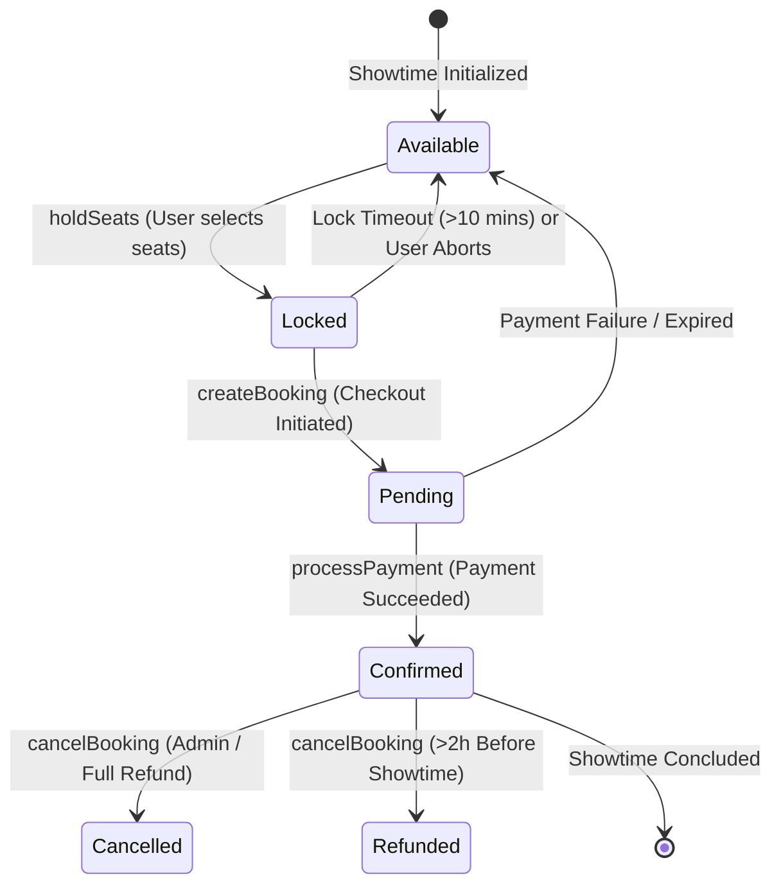

# Technical Architecture

## 1. System Overview

IMovies is a full-stack, real-time movie ticket booking web platform designed with high concurrency control, seat reservation locks, and a multi-tiered component structure. The architecture combines a client-side Single Page Application (SPA) built with React 19, TypeScript, and Tailwind CSS, coupled with an Express 4 RESTful API backend running on Node.js 22.

The system utilizes an in-memory document store repository that mirrors MongoDB collection semantics, schema constraints, and index validation, while allowing an external MongoDB connection when configured via `MONGODB_URI`.

```mermaid
graph TD
    subgraph ClientLayer ["Client Layer (Browser / SPA)"]
        UI["React 19 Frontend<br/>(Tailwind CSS, Lucide Icons, Vite)"]
        State["Client State & Storage<br/>(LocalStorage Token, Hold Timer)"]
        ApiClient["ApiClient (Typed Fetch Service)"]
        UI --> ApiClient
        ApiClient <--> State
    end

    subgraph GatewayLayer ["Network & Middleware Layer"]
        HTTP["HTTP / Reverse Proxy (Port 3000)"]
        ViteDev["Vite Dev Middleware (HMR/Assets)"]
        ExpressApp["Express Application (server.ts)"]
        AuthMid["authMiddleware (JWT / HMAC-SHA256)"]
        ValMid["validationMiddleware (Payload Validator)"]
        ErrMid["errorHandlerMiddleware (Standard JSON Errors)"]
        
        HTTP --> ViteDev
        HTTP --> ExpressApp
        ExpressApp --> AuthMid
        ExpressApp --> ValMid
        ExpressApp --> ErrMid
    end

    subgraph ServiceLayer ["Controllers & Business Services (MVC)"]
        AuthCtrl["AuthController / AuthService"]
        MovieCtrl["MovieController / MovieSyncService"]
        CinemaCtrl["CinemaController"]
        ShowtimeCtrl["ShowtimeController"]
        BookingCtrl["BookingController / BookingService"]
        PaymentCtrl["PaymentController / PaymentService"]
        AdminCtrl["AdminController"]

        ExpressApp --> AuthCtrl
        ExpressApp --> MovieCtrl
        ExpressApp --> CinemaCtrl
        ExpressApp --> ShowtimeCtrl
        ExpressApp --> BookingCtrl
        ExpressApp --> PaymentCtrl
        ExpressApp --> AdminCtrl
    end

    subgraph DataLayer ["Data & Repository Layer"]
        DB["MongoDB Document Repository (Database)"]
        UsersCol[("users")]
        MoviesCol[("movies")]
        CinemasCol[("cinemas")]
        ScreensCol[("screens")]
        ShowtimesCol[("showtimes")]
        SeatsCol[("seatReservations")]
        ConcessionsCol[("concessions")]
        BookingsCol[("bookings")]
        PaymentsCol[("payments")]

        DB --> UsersCol
        DB --> MoviesCol
        DB --> CinemasCol
        DB --> ScreensCol
        DB --> ShowtimesCol
        DB --> SeatsCol
        DB --> ConcessionsCol
        DB --> BookingsCol
        DB --> PaymentsCol
    end

    subgraph ExternalServices ["External Services & Integrations"]
        TMDB["External Movie Data Adapter<br/>(TMDB / IMDb Catalog Sync)"]
        SimGateway["Simulated Payment Gateway<br/>(Card, UPI, NetBanking, Wallets)"]
    end

    MovieCtrl <--> TMDB
    PaymentCtrl <--> SimGateway
    ServiceLayer <--> DB
```

---

## 2. Core Architectural Components

### 2.1 React Frontend
- **Framework & Build**: React 19 SPA bundled with Vite 8 and TypeScript.
- **Styling**: Tailwind CSS v4 using modern clean typography, dark zinc canvas (`bg-zinc-950`), subtle borders, and amber accents (`text-amber-400`).
- **Interactive Modules**:
  - **Hero Blockbuster**: Highlights featured films with backdrop scrims and YouTube trailer modal integration.
  - **Movie Catalog & Filters**: Status filter (Now Showing / Coming Soon), genre tags, real-time search.
  - **Cinema Selector**: Multi-city selection (New York, Los Angeles, Chicago, London) with auditorium amenities.
  - **Curved Interactive Seat Map**: Curved cinema screen glow, row-by-row seat matrix with seat tiers (Standard, Premium, VIP), real-time status indication (Available, Selected, Reserved, Locked).
  - **10-Minute Reservation Hold Timer**: Real-time MM:SS countdown timer tied to server-side hold locks with automatic seat release on expiry.
  - **Concession Add-ons**: Snack and beverage selectors with quantity steppers.
  - **Checkout Module**: Discount coupon validation (`IMOVIES10`), fee calculations, test credentials autofill.
  - **Digital Ticket Pass**: Perforated digital pass with scannable QR code and cancellation/refund calculation.
  - **Admin Operations Portal**: Real-time KPI dashboard, showtime scheduler, and booking ledger.

### 2.2 Express Backend & REST APIs
- **Entry Point**: `server.ts` mounts Express 4 with JSON and urlencoded parsers.
- **Routing**: Modular route handlers organized under `/api/v1`:
  - `/api/v1/auth`: Authentication and profile
  - `/api/v1/movies`: Catalog discovery and movie management
  - `/api/v1/cinemas`: Locations, screens, and concessions
  - `/api/v1/showtimes`: Showtime schedules and auditorium seat maps
  - `/api/v1/bookings`: Seat locking (`/hold`), release (`/release`), checkout, and cancellation
  - `/api/v1/payments`: Simulated payment processing and status checks
  - `/api/v1/admin`: Operational stats, all bookings ledger, and showtime creation
- **Development Integration**: Mounts `vite.middlewares` in development mode, ensuring API routes and frontend client run synchronously on port 3000.

### 2.3 Authentication & Session Management
- **Token Mechanism**: JSON Web Token (JWT) using HMAC-SHA256 signature verification implemented in `AuthService`.
- **Payload**: Contains `userId`, `email`, `role` (`guest`, `user`, or `admin`), `name`, and 7-day expiration timestamp (`exp`).
- **Storage**: Client stores token in `localStorage` and transmits via `Authorization: Bearer <token>` header.
- **Role-Based Access Control**:
  - `authenticate` middleware enforces valid token presence.
  - `optionalAuth` allows anonymous guest checkouts while attaching identity if signed in.
  - `requireRole(['admin'])` restricts admin dashboard and movie/showtime creation endpoints.

### 2.4 External Movie-Data Integration
- **Implementation**: Managed by `MovieSyncService`.
- **Integration Role**: Adapts external metadata (such as TMDB or IMDb) into internal `Movie` entities, mapping backdrop images, posters, trailers, genres, ratings, and screen formats.
- **Fallback**: Pre-seeded with 6 blockbusters (Dune: Part Two, Oppenheimer, Interstellar, Spider-Man, Inside Out 2, Past Lives) to ensure high-availability without requiring external API keys.

### 2.5 Booking Lifecycle & Concurrency Control

1. **Seat Hold (10-Minute Lock)**:
   - When a customer selects seats, `/api/v1/bookings/hold` verifies the seats are `available`.
   - The status is atomically changed to `locked`, stamped with `userId`, `lockedAt`, and `expiresAt` (10 minutes in the future).
   - If another user requests the same seat within the 10-minute window, the server rejects the request with HTTP 409 Conflict.
2. **Auto-Cleanup**:
   - `server.ts` executes a periodic background job every 30 seconds (`db.cleanupExpiredSeatLocks()`) that resets expired locks to `available`.
3. **Checkout Transition**:
   - The user proceeds to checkout; a pending booking record is created with subtotal, convenience fees ($1.75/ticket), and municipal taxes (8.875%).
4. **Settlement**:
   - Upon payment settlement, `confirmBooking()` marks seat records as `booked` permanently and marks the booking as `confirmed`.
5. **Cancellation & Refund Policy**:
   - **> 2 Hours before showtime**: 100% refund issued, booking transitioned to `refunded`, seats released to `available`.
   - **1 – 2 Hours before showtime**: 50% partial refund issued.
   - **< 1 Hour or post-showtime**: Ineligible for refund; booking transitioned to `cancelled`.

### 2.6 Payment Workflow
- **Service**: Handled by `PaymentService`.
- **Supported Channels**:
  - Credit / Debit Card (Card number, expiry, CVV, cardholder)
  - Unified Payments Interface (UPI) Instant Payment (VPA address)
  - Cinema Digital Wallet
- **Simulation Features**:
  - Deterministic test card (`4242 4242 4242 4242`) and UPI ID (`member@okhdfcbank`).
  - Failure testing: Entering a card ending in `0002` or checking "Simulate Bank Decline" simulates card issuer authorization rejection, rolling back pending state.
  - Generates unique transaction references (`TXN-CARD-XXXX`, `TXN-UPI-XXXX`) and authorization codes.
