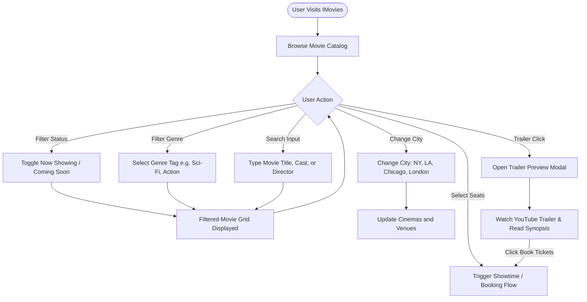
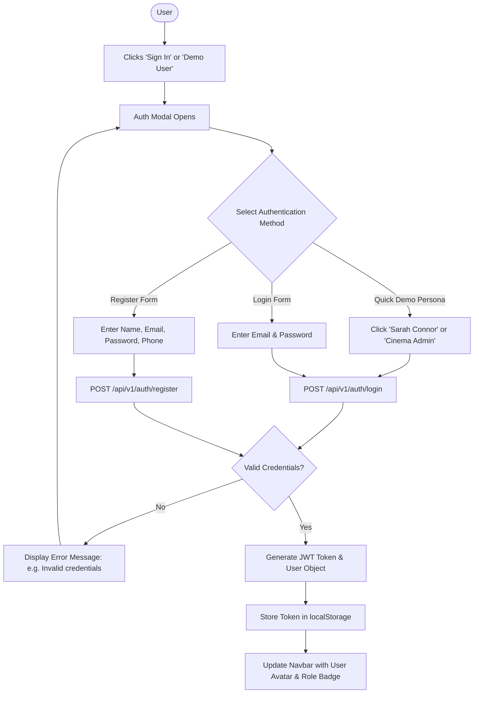
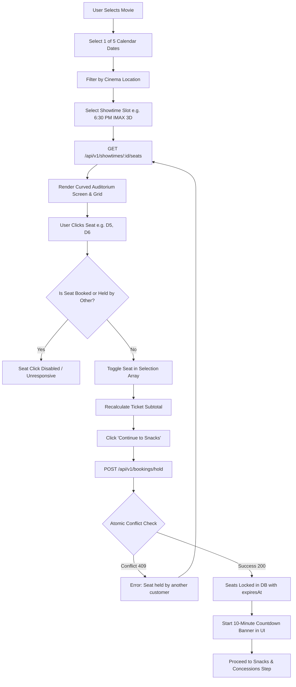
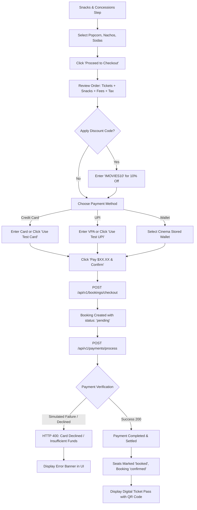
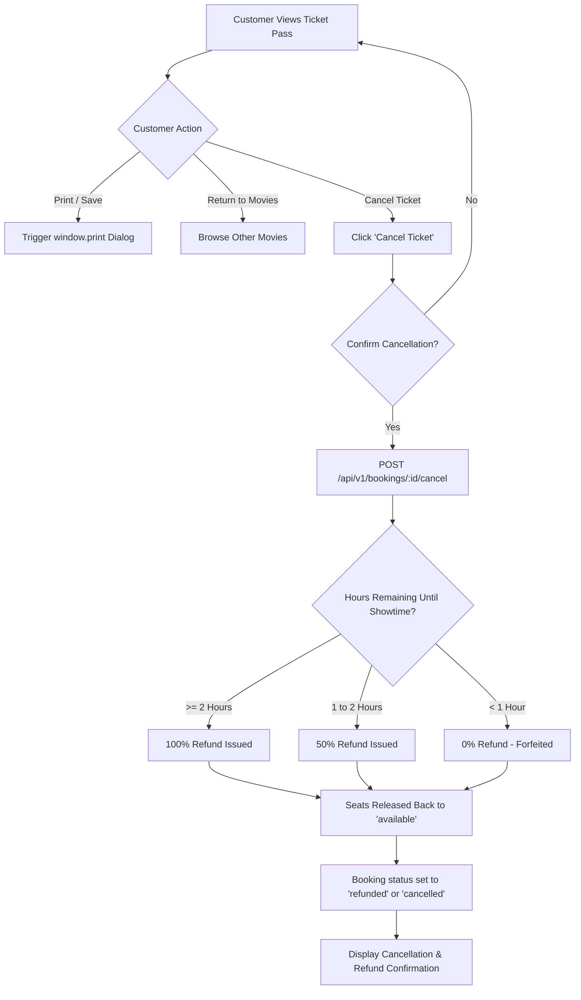
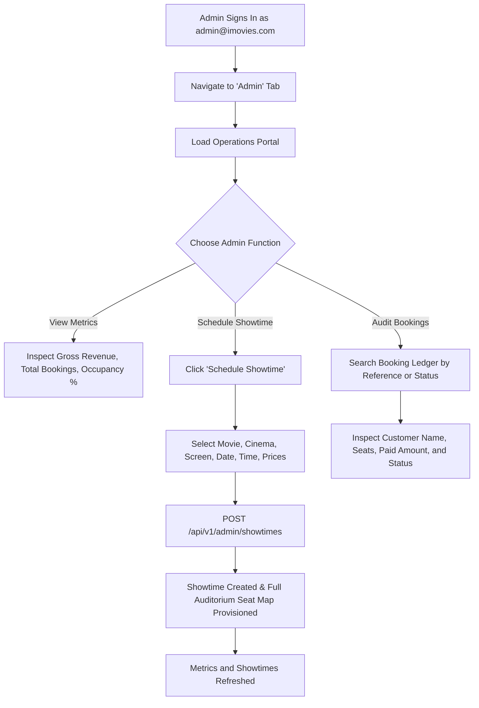

# User Flow Diagrams

## 1. Movie Discovery Flow

This flow illustrates how visitors search, filter, and inspect movie details and trailers.

---

## 2. Authentication Flow (Login & Register)

---

## 3. Seat Selection & Reservation Flow (10-Minute Hold)

---

## 4. Booking, Snacks, and Payment Checkout Flow

---

## 5. Booking Confirmation & Cancellation Flow

---

## 6. Administrator Operations Flow

